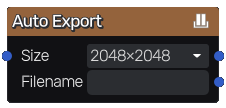

Auto Export node
~~~~~~~~~~~~~~~~

The **Auto Export** node defines a texture that will be saved together automatically when the node's input changes.

Inputs
++++++

The **Auto Export** node has an input that will be saved automatically upon changes.

Outputs
+++++++

The **Auto Export** node does not have any output.

Parameters
++++++++++

The **Auto Export** node has two parameters:

* *Resolution* size of the exported file

* *Filename* of the created file. The path is relative to the project folder.
