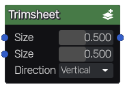
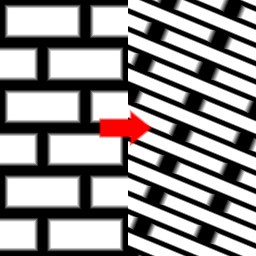

Trimsheet node
~~~~~~~~~~~~~~

The **Trimsheet** node is variadic and can be used to create trimsheets.

Inputs
++++++

The **Trimsheet** node accepts several color images as input.

Outputs
+++++++

The **Trimsheet** node outputs the generated trimsheet.

The input images are cut and assembled according to the trimsheet layout.

Parameters
++++++++++

The **Trimsheet** node has the following parameters:

* a *Size* for each trim strip
* the trimsheet *Direction* (horizontal or vertical)

Example images
++++++++++++++

